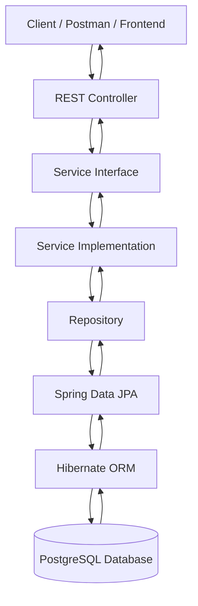
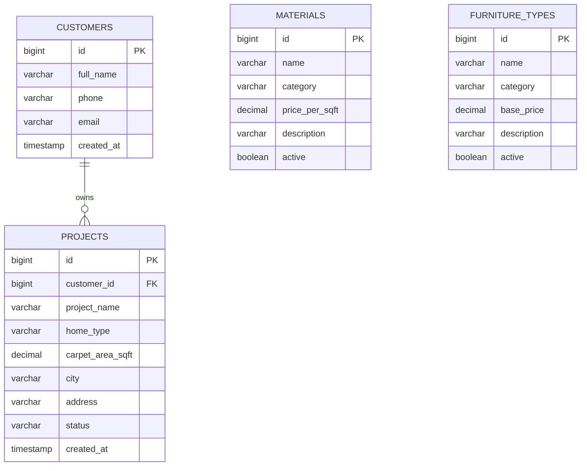
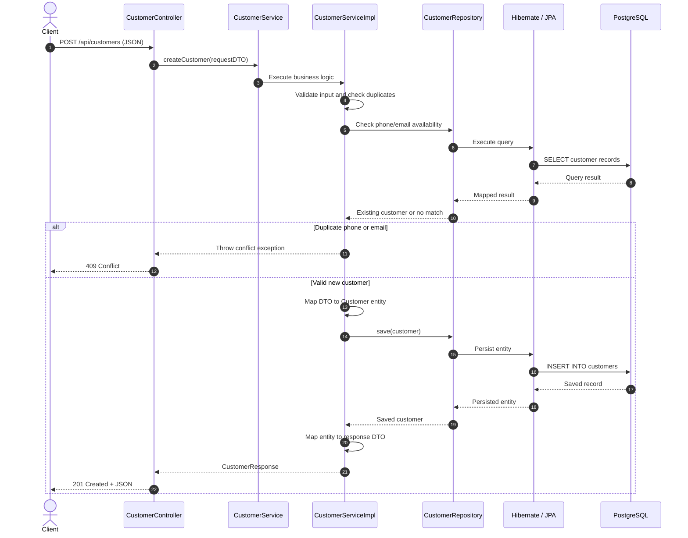
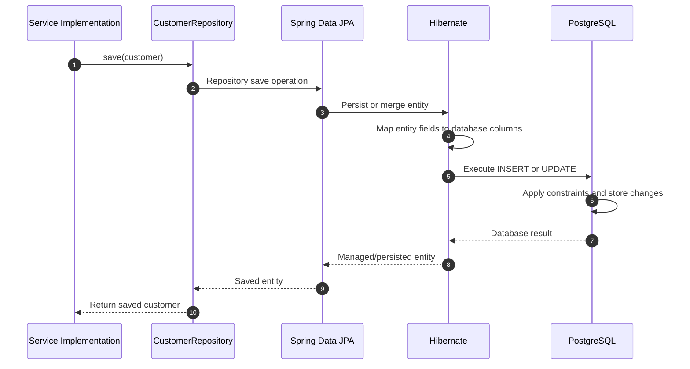

# FurnitureWala Backend

FurnitureWala is a Spring Boot backend application for managing customers, interior design projects, materials, and furniture types. It exposes REST APIs and uses PostgreSQL for persistent data storage through Spring Data JPA and Hibernate.

## 1. Technology Stack

- **Java:** Java 17
- **Backend:** Spring Boot
- **Database:** PostgreSQL
- **ORM:** Hibernate / JPA
- **Data access:** Spring Data JPA
- **API documentation:** Swagger / OpenAPI
- **Build tool:** Maven
- **Boilerplate reduction:** Lombok

## 2. Application Architecture

The application follows a layered architecture. Each layer has a specific responsibility.



### Responsibilities of each layer

| Layer | Responsibility |
|---|---|
| Controller | Receives HTTP requests and returns HTTP responses. |
| DTO | Defines request and response data structures. |
| Service | Contains business logic and validation rules. |
| Service Implementation | Implements service operations and coordinates repositories. |
| Repository | Provides database access through Spring Data JPA. |
| Entity / Model | Represents database tables and their fields. |
| Hibernate / JPA | Maps Java entities to database records. |
| PostgreSQL | Stores application data permanently. |
| Exception Handler | Converts application errors into appropriate HTTP responses. |

## 3. Database Design

The application uses PostgreSQL to store customer, project, material, and furniture-type information.

### 3.1 Customers Table

Stores customer details.

| Column | Description |
|---|---|
| `id` | Primary key |
| `full_name` | Customer's full name |
| `phone` | Customer's phone number |
| `email` | Customer's email address |
| `created_at` | Record creation timestamp |

The `id` uniquely identifies each customer. Phone numbers and email addresses can be checked for duplicates by the service layer.

### 3.2 Projects Table

Stores interior design project details associated with customers.

| Column | Description |
|---|---|
| `id` | Primary key |
| `customer_id` | Foreign key referencing `customers.id` |
| `project_name` | Name of the project |
| `home_type` | Type of home |
| `carpet_area_sqft` | Carpet area in square feet |
| `city` | Project city |
| `address` | Project address |
| `status` | Current project status |
| `created_at` | Record creation timestamp |

The `customer_id` column links a project to its customer.

### 3.3 Materials Table

Stores the available materials catalogue.

| Column | Description |
|---|---|
| `id` | Primary key |
| `name` | Material name |
| `category` | Material category |
| `price_per_sqft` | Price per square foot, where applicable |
| `description` | Material details |
| `active` | Indicates whether the material is active |

### 3.4 Furniture Types Table

Stores the available furniture types catalogue.

| Column | Description |
|---|---|
| `id` | Primary key |
| `name` | Furniture type name |
| `category` | Furniture category |
| `base_price` | Base price |
| `description` | Furniture details |
| `active` | Indicates whether the furniture type is active |

> **Note:** These table definitions describe the intended database design. Verify that the entity classes and migrations in the repository use the same fields and table names. Materials and furniture types are standalone catalogues unless explicit relationships are implemented.

## 4. Entity Relationship Diagram

The main relationship is between customers and projects.

One customer can have multiple projects, while each project belongs to one customer.



### Relationship explanation

- **Customers → Projects:** One-to-many relationship.
- **Projects → Customers:** Each project references a customer using `customer_id`.
- **Materials:** Independent catalogue of available materials.
- **Furniture Types:** Independent catalogue of available furniture types.

The one-to-many relationship requires a foreign key in the projects table. In Java, this may be represented using `@ManyToOne` in the project entity and optionally `@OneToMany` in the customer entity. The annotations must match the actual entity implementation.

## 5. How REST APIs Work

A typical API request follows this process:

1. The client sends an HTTP request with a URL, method, and optionally a JSON body.
2. The controller receives the request and delegates it to the service layer.
3. The service validates the input and executes the business rules.
4. The repository performs the required database operation.
5. Spring Data JPA and Hibernate translate the operation into SQL.
6. PostgreSQL reads or updates the relevant records.
7. The service maps the result to a response DTO.
8. The controller returns the response with the appropriate HTTP status code.

## 6. API Request Sequence Diagram

The following example illustrates creating a customer using `POST /api/customers`.



*The exact status codes and validation behavior depend on the controller, service, and exception-handler implementation.*

## 7. Database Operation Sequence Diagram

This diagram shows how a customer record moves through the backend when it is saved.



Hibernate manages the mapping between Java objects and database rows. SQL execution and transaction completion depend on the persistence context and transaction configuration.

## 8. Typical CRUD API Endpoints

The following table describes a conventional REST API structure. Confirm the exact paths and supported methods against the project's controllers.

| HTTP Method | Example Endpoint | Purpose |
|---|---|---|
| `POST` | `/api/customers` | Create a customer |
| `GET` | `/api/customers` | Retrieve all customers |
| `GET` | `/api/customers/{id}` | Retrieve one customer |
| `PUT` | `/api/customers/{id}` | Update a customer |
| `DELETE` | `/api/customers/{id}` | Delete a customer |
| `POST` | `/api/projects` | Create a project |
| `GET` | `/api/projects` | Retrieve projects |
| `GET` | `/api/projects/{id}` | Retrieve one project |
| `PUT` | `/api/projects/{id}` | Update a project |
| `DELETE` | `/api/projects/{id}` | Delete a project |
| `POST` | `/api/materials` | Create a material |
| `GET` | `/api/materials` | Retrieve materials |
| `POST` | `/api/furniture-types` | Create a furniture type |
| `GET` | `/api/furniture-types` | Retrieve furniture types |

Additional update and delete operations for materials and furniture types may be provided depending on the implemented controllers.

## 9. Example Customer API Request

### Request

```http
POST /api/customers
Content-Type: application/json
```

Example JSON body:

```json
{
  "fullName": "Rahul Thombare",
  "phone": "9876543210",
  "email": "rahul@example.com"
}
```

Use test data when trying this request in a development environment.

### Example response

```json
{
  "id": 1,
  "fullName": "Rahul Thombare",
  "phone": "9876543210",
  "email": "rahul@example.com",
  "createdAt": "2026-01-15T10:30:00Z"
}
```

The values above are illustrative; the generated ID and timestamp will depend on the database and application configuration.

## 10. HTTP Status Codes and Error Handling

| Status Code | Meaning | Example |
|---|---|---|
| `200 OK` | Request completed successfully | Fetch or update a record |
| `201 Created` | A new resource was created | Create a customer |
| `204 No Content` | Request succeeded without a response body | Delete a record |
| `400 Bad Request` | Invalid input | Missing required field |
| `404 Not Found` | Requested resource does not exist | Customer ID not found |
| `409 Conflict` | Request conflicts with existing data | Duplicate phone or email |
| `500 Internal Server Error` | Unexpected server error | Unhandled backend failure |

These are common conventions. The actual status codes depend on how exceptions and responses are handled in the application.

## 11. Swagger API Documentation

When the application is running locally on port `8080`, open:

- **Swagger UI:** http://localhost:8080/swagger-ui/index.html
- **OpenAPI JSON:** http://localhost:8080/v3/api-docs
- **OpenAPI YAML:** http://localhost:8080/v3/api-docs.yaml

Swagger UI allows you to inspect available endpoints, review request and response schemas, and test supported APIs.

## 12. Running the Application

### Prerequisites

- Java 17 or the version configured by the project
- Maven or the included Maven Wrapper
- PostgreSQL
- A configured database and valid database credentials

### Steps

1. Clone the repository:

   ```bash
   git clone https://github.com/rahulthombare29/furnitureWala.git
   cd furnitureWala
   ```

2. Configure PostgreSQL connection settings in `src/main/resources/application.properties` or `application.yml`, according to the project's configuration.

   Example configuration:

   ```properties
   spring.datasource.url=jdbc:postgresql://localhost:5432/furniturewala
   spring.datasource.username=YOUR_DB_USERNAME
   spring.datasource.password=YOUR_DB_PASSWORD

   spring.jpa.hibernate.ddl-auto=update
   spring.jpa.show-sql=true
   ```

   Replace the placeholders with your local database credentials. The Hibernate DDL setting shown is an example for development, not a recommended production migration strategy.

3. Run the application using the Maven Wrapper, if present:

   **Windows:**

   ```bat
   mvnw.cmd spring-boot:run
   ```

   **Linux/macOS:**

   ```bash
   ./mvnw spring-boot:run
   ```

   Alternatively, if Maven is installed:

   ```bash
   mvn spring-boot:run
   ```

4. Open Swagger UI and test the available endpoints.

## 13. Summary

FurnitureWala uses a layered Spring Boot architecture to separate HTTP handling, business logic, and data access.

The key database relationship is between customers and projects, connected through `projects.customer_id`. Spring Data JPA and Hibernate handle entity persistence and database interaction, while PostgreSQL stores the records. DTOs provide a structured API contract, and Swagger makes the endpoints easier to explore and test.

